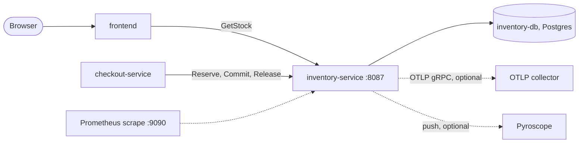

# Architecture

## Context



inventory-service calls no other service. The callers are the frontend (`GetStock`) and checkout-service (`Reserve`, `Commit`, `Release`), both only when `INVENTORY_SERVICE_ADDR` is set; checked against the `origin/main` code of the callers on 2026-11-21.

## Main flow: placing an order

```mermaid
sequenceDiagram
    participant CO as checkout-service
    participant IN as inventory-service
    participant DB as inventory-db
    CO->>IN: Reserve(order_id, items)
    IN->>DB: BEGIN; order lock; SELECT stock FOR UPDATE (ascending id)
    alt enough stock for every line
        IN->>DB: UPDATE stock (available >= q); INSERT reservation; COMMIT
        IN-->>CO: reserved = true
        Note over CO: charge card, ship
        CO->>IN: Commit(order_id)
        IN->>DB: RESERVED to COMMITTED
        IN-->>CO: OK
    else any line short
        IN-->>CO: reserved = false, shortages (nothing held)
    end
    Note over CO,IN: on any failure after Reserve: Release(order_id) returns the stock; a hold nobody commits expires after RESERVATION_TTL
```

The order of the steps inside checkout is described in checkout-service's own documentation.

## Start-up and readiness

1. Configuration is read (an invalid `RESERVATION_TTL` or `SWEEP_INTERVAL` stops the process; telemetry and profiling are off unless their variables are set).
2. The gRPC server listens at once, health is `NOT_SERVING`.
3. A background loop runs the goose migrations and the seed (retry every 2 s), then starts the sweep and pings the database every 5 s; health follows the ping.

## State machine

```
            Reserve (enough stock)                 Commit
 (none) ----------------------------> RESERVED ------------------> COMMITTED   (final, never expires, never returned)
                                        |   |
                      Release           |   | expires_at <= now (lazy or sweep)
                                        v   v
                                       RELEASED                                  (final; the order id cannot be reserved again)
```

- `Reserve` takes `available` down by the quantities and stores the reservation (`expires_at = now + RESERVATION_TTL`). A refused `Reserve` (shortage) stores nothing, so the same order id may be tried again later with any lines.
- `Release` and expiry add the quantities back, exactly once (the status change and the stock update are one transaction, and the status change is conditional on `RESERVED`).
- Expiry: a RESERVED hold with `expires_at <= now` counts as gone. It is turned into RELEASED (stock returned) **lazily** by the first `GetStock`/`Reserve` that involves one of its products (at most 100 holds per call, each in its own transaction, before the call does its own work), by a `Commit`/`Reserve`/`Release` of that very order id (same transaction), or by the **background sweep** (every `SWEEP_INTERVAL`, default one minute, per process, 200 holds per batch until none is left). There is no cron.
- Invariant (checked by the integration tests after every race): for each product, `available + quantities of RESERVED and COMMITTED reservations = initial stock`, and `available` is never negative.

## How a reservation is made safe

- `available` has `CHECK (available >= 0)`; the decrement is `UPDATE stock SET available = available - q WHERE product_id = $1 AND available >= q` and the row count must be 1.
- `Reserve` locks the needed stock rows with one `SELECT ... WHERE product_id = ANY(...) ORDER BY product_id FOR UPDATE` (ascending id), so two orders with the same products in opposite line order wait for each other in the same order and cannot deadlock. Then it computes all shortages; only if there are none does it decrement and insert the reservation.
- Every change of ONE order first takes that order's transaction-level advisory lock (`pg_advisory_xact_lock`), then the reservation row (`FOR UPDATE`), then stock rows in ascending order. A transaction holds at most one order lock, so order locks cannot form a cycle. This serialises `Commit`, `Release`, the expiry of that hold and a replayed `Reserve` of the same order, so exactly one of `Commit` and the expiry wins and a committed reservation never has its stock returned.
- Time comes from the process clock (`now` is passed to the store). Replicas with clocks that differ by more than a few seconds would disagree about the exact moment of expiry, never about stock.

## Seed stock

`data/stock.json` (embedded in the binary) holds `product_id -> available` copied from the `stock` field of the catalog seed, `apps/product-catalog-service/data/seed/products.json` (117 products, 0-100 pieces). At start the service inserts every product that has no stock row yet: `INSERT ... ON CONFLICT DO NOTHING`. It never changes an existing row, so a restart (or a second replica) never resets live stock, and changing a number in the catalog later does **not** change the stock of a product that is already in the database.

Keeping the copy honest:

```bash
python3 tools/sync_stock.py            # rewrites data/stock.json from ../product-catalog-service/data/seed/products.json
python3 tools/sync_stock.py --check    # exit 0 when it matches, 1 with the differences, 2 when the catalog file is missing
CATALOG_SEED=/path/to/products.json go test ./internal/inventory -run TestSeedMatchesCatalog -v
```

`TestSeedMatchesCatalog` fails when the copy has drifted (a changed number, a product added to or removed from the catalog); it is skipped, with a message saying that drift was NOT checked, when the catalog file cannot be found (default: the sibling checkout, or `CATALOG_SEED`).
